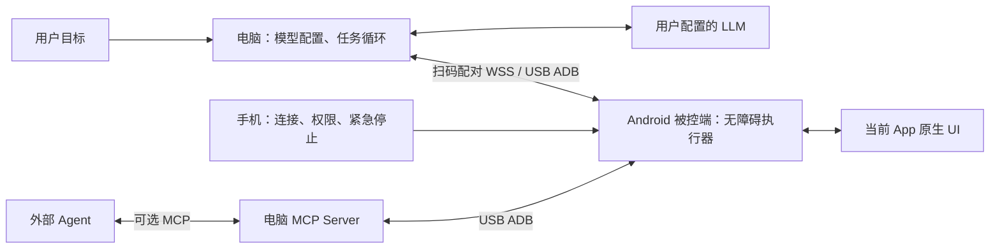
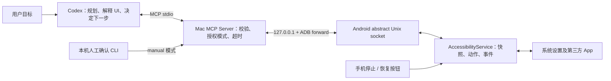

# TapPilot 架构与实施边界

## 当前架构（v0.3.7）

电脑运行 TapPilot 桌面客户端，用户在电脑配置自己的模型、输入任务、查看进度和结果。手机只有连接与权限界面，以及无障碍观测和动作执行能力。Chat Completions 兼容工具调用及任务循环均在电脑运行；MCP 是供外部 Agent 使用的可选适配。

两种模式都需要电脑控制手机。USB 模式需要用户授权 USB 调试；扫码模式在同一局域网内运行，不需要开发者选项、ADB 或数据线。手机的 INTERNET 权限用于主动 WSS 连接，不用于调用模型。配对认证、互斥执行和断线行为见 [wireless.md](wireless.md)，电脑任务循环与效率措施见 [clients.md](clients.md)。

**下文保留 v0.1 的调研与 USB/MCP 实施记录**；“不申请 INTERNET”“模型留在 Codex”等描述仅适用于该阶段。v0.2 引入的手机独立模型运行功能已在 v0.3.7 移除。

## v0.1 架构记录

资料核对日期：2026-10-16。本文区分 Android 的平台能力、本项目的实现选择和后续计划；源码及依赖锁文件是具体版本的准据。

## 推荐架构

采用 **Kotlin AccessibilityService + macOS TypeScript MCP stdio 服务 + ADB 转发**。模型留在 Codex 内，手机负责观测与执行；手机不部署 LLM、OCR 或工作流引擎。

Android 使用 `LocalServerSocket("tappilot")`，不申请 `INTERNET` 权限，不开启手机 TCP/HTTP 服务。ADB 把 Mac 上临时端口转发至 `localabstract:tappilot`；服务检查连接方的 Unix peer UID，只接受 `shell`（2000）或系统 `root`（0）的 ADB 侧进程。允许 UID 0 是兼容系统的 adbd 身份，不要求或尝试 Root。普通 Android App 的 UID 不能直接使用此接口。抽象 socket 和 peer credentials 是平台公开 API。[LocalServerSocket](https://developer.android.com/reference/android/net/LocalServerSocket)、[LocalSocket](https://developer.android.com/reference/android/net/LocalSocket)

ADB 授权是设备与电脑之间的信任边界，MVP 不防御已控制该 Mac 账户或已获 ADB 权限的程序。使用默认本机 ADB 服务，不以 `adb -a` 启动，不配置无线调试或公网隧道；`tcp:0` 让 ADB 分配可用端口。ADB 的全部网卡监听选项会影响转发的暴露面，部署时应确认监听只在回环地址。[ADB 手册](https://android.googlesource.com/platform/packages/modules/adb/+/refs/heads/main/docs/user/adb.1.md)、[ADB socket 实现](https://android.googlesource.com/platform/packages/modules/adb/+/f4965b77c694689c08855076eaf983c8e88646f9/socket_spec.cpp)

## 可复用项目的结论

| 项目 | 已核实的能力和许可证 | 本项目采用方式 |
| --- | --- | --- |
| [官方 MCP TypeScript SDK](https://github.com/modelcontextprotocol/typescript-sdk) | MCP 工具注册、schema、stdio；当前主线 v2，v1 另行维护，许可以所安装版本为准 | 本项目固定已验证的 `@modelcontextprotocol/sdk@1.32.1`（v1 兼容线）及 lockfile，不宣称它是最新主线，不自行重写 MCP |
| [mobile-next/mobile-mcp](https://github.com/mobile-next/mobile-mcp) | Android/iOS、设备和截图工具；Apache-2.0 | 成熟对照方案；其 [Android 实现](https://github.com/mobile-next/mobile-mcp/blob/main/src/android.ts) 使用 `uiautomator dump`，不作为本项目常驻事件服务的底座 |
| [danielealbano/android-remote-control-mcp](https://github.com/danielealbano/android-remote-control-mcp) | Kotlin Android 无障碍控制、手机端 HTTP MCP、认证和网络功能；MIT | 最接近需求，可直接试用的替代品；本项目保留最小 APK 和仅 ADB 边界，不引入其完整网络/文件/权限功能 |
| [openatx/uiautomator2](https://github.com/openatx/uiautomator2) | Python 客户端与设备端 UiAutomator HTTP 服务；MIT | 适合现成自动化基线及对照排障；运行模型不同，不混入 AccessibilityService 生命周期 |

结论不是重新实现整套自动化框架：复用官方 MCP、ADB、Android 无障碍 API；只编写连接这些能力所需的最小适配层、快照标识和安全控制。上述自动化仓库是调研参考，未复制它们的源码；以后引入代码时，应保留对应版本的版权、许可证和必要 NOTICE。

## Android 可行性与限制

公开 API 足以实现读取当前可访问 UI、`ACTION_CLICK`、`ACTION_SET_TEXT`、滚动、全局返回/Home 和手势。`ACTION_SET_TEXT` 直接接受 Unicode 字符串，避免 `adb shell input text` 对中文的限制；目标控件必须实现相应动作，返回成功仍需要下一次观测验证业务效果。[AccessibilityService](https://developer.android.google.cn/reference/android/accessibilityservice/AccessibilityService)、[AccessibilityAction](https://developer.android.google.cn/reference/android/view/accessibility/AccessibilityNodeInfo.AccessibilityAction)

| 问题 | 处理原则 |
| --- | --- |
| 生命周期 | 系统管理服务，用户必须手动启用；只在 `onServiceConnected` 后暴露控制，在断开/销毁时关闭 socket、等待任务和快照。不能把 Activity 存活视为服务可用。`onInterrupt` 是反馈中断回调，不等于用户撤销权限。 |
| 线程与卡顿 | socket I/O 和事件等待不阻塞主线程；节点读取和动作统一串行调度，回调只更新轻量状态。不要把 `AccessibilityNodeInfo` 对象跨请求、跨线程长期缓存。 |
| 失效节点 | ID 只属于一次服务会话和快照。动作前重新获取根节点，检查版本、窗口、路径和指纹；过期返回错误并要求重新观察，不自动改点相似文字。 |
| 当前 Activity | 包名来自当前可访问窗口；事件的 className 只作窗口线索，不保证是真实前台 Activity。多窗口、输入法、弹窗可能改变 active root。 |
| UI 完整性 | 树是 App 提供的无障碍语义，不是屏幕像素的完整表示。未渲染的列表内容、Canvas/游戏、自绘图表、部分 WebView 可能缺少节点；resourceId 也可能为空或重复。 |
| Compose/WebView | Compose 的语义会合并或清除；WebView 的虚拟节点受页面结构影响。以实际返回内容为准，不假设一种控件框架必然完整可用。 |
| 安全界面 | 锁屏由用户手动解锁；密码节点不输出文本、不接受输入；验证码、生物识别和 App 防自动化界面交给用户。敏感视图可能被平台过滤，不能承诺读取。 |
| 系统差异 | OEM 的省电/后台限制、无障碍保护和设置页面结构不同，需要目标真机验证。系统设置中的“电池”入口名称可用于语义检索，不能当作所有 ROM 的固定 ID。 |

生命周期依据：[Android 服务指南](https://developer.android.com/guide/topics/ui/accessibility/views/service)。节点 `refresh()` 失败代表节点已不在 View 树；本项目进一步使用快照约束防止误操作。[AccessibilityNodeInfo](https://developer.android.com/reference/android/view/accessibility/AccessibilityNodeInfo)

自绘内容只有 App 提供虚拟无障碍层次时才能按节点访问；Compose 语义也由目标 App 决定。[AccessibilityNodeProvider](https://developer.android.com/reference/android/view/accessibility/AccessibilityNodeProvider)、[Compose semantics](https://developer.android.com/develop/ui/compose/accessibility/semantics)、[语义合并与清除](https://developer.android.com/develop/ui/compose/accessibility/merging-clearing)

`accessibilityDataSensitive` 等限制不能通过伪装 `isAccessibilityTool=true` 绕过。本项目不是专为残障用户设计的系统辅助工具，不作该声明。Google Play 当前对一般应用的自主无障碍自动化有严格限制；本项目交付的是用户授权、ADB 侧载的开发原型，不承诺符合 Play 上架条件。[Android 敏感视图保护说明](https://developer.android.com/blog/posts/enhancing-android-security-stop-malware-from-snooping-on-your-app-data)、[Google Play AccessibilityService 政策](https://support.google.com/googleplay/android-developer/answer/10964491?hl=en-EN)

## 第一阶段的实现取舍

1. **可运行链路**：最小控制 App、无障碍服务、ADB 本机转发、MCP 工具注册；安装和授权由用户在真机完成。
2. **结构化观测**：有界 JSON 快照，保留父子关系、文字、描述、ID、类型、bounds 和动作属性；裁剪不可见节点，保留必要容器和重复标签以免误删不同列表项。空容器压缩和跨快照去重留到第二阶段。只处理当前暴露的窗口内容。
3. **动作闭环**：查找返回当前快照中的 `nodeId`；点击、输入、滚动必须重新验证；然后等待事件并重新获取 UI，判断是否到达预期页面。
4. **事件等待**：`wait_for_ui_change` 以事件 revision 为基准；可传 selector 等特定控件出现。等待不会持续抓取完整树，也不把任意一次事件当作页面加载完成。
5. **启动时选择授权模式**：`TAPPILOT_APPROVAL_MODE` 默认为 `manual`，所有点击、文字输入和自由手势要求独立人工确认。用户持续授权后可配置 `trusted`，必须用 `TAPPILOT_SERIAL` 固定本人 USB 设备，点击、输入和手势直接执行。两种模式都保留快照校验、锁屏/密码保护和急停；滚动、返回、Home、打开系统设置均无需确认。模式不能通过 MCP 参数切换，配置更新后需重启连接，无需重装 APK。服务不依靠关键词判定所有危险动作，代理仍按用户任务范围执行。
6. **停止与最少留存**：手机与主机均有停止状态；停止后拒绝后续控制，只允许人工恢复。日志保留方法、结果代码和耗时，不落盘 UI 树或输入内容。节点文本仍会作为工具结果发送给 Codex；Codex/模型服务的会话留存由其自身设置决定。

本阶段的验收是：**Codex 根据实时 UI 动态决策，按启动时配置的授权模式执行，手机返回真实状态**。`manual` 模式保留逐次批准，`trusted` 模式支持已授权设备的连续操作；两种模式都在每次动作后读取并判断结果。跨 App 工作流和视觉回退仍属于后续范围。详细协议与失败处理见 [protocol.md](protocol.md)。

## 第二阶段

在真机闭环稳定后再增加截图与视觉回退、经过审计的低风险动作授权、跨 App 任务状态、受限批处理、差量树和更完善的等待条件。批处理应为每一步设前置/后置条件，遇到失败或高风险动作立即停止，不把整批授权等同于任意操作授权。

截图不能恢复被系统保护的内容，Android 明确提供安全窗口截图失败状态；第二阶段也必须遵守这个边界。[截图 API](https://developer.android.com/reference/android/accessibilityservice/AccessibilityService#ERROR_TAKE_SCREENSHOT_SECURE_WINDOW)
