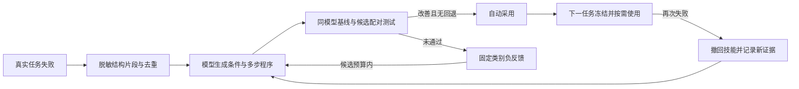
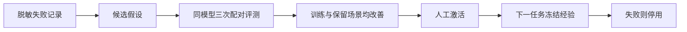

# 失败学习与回归评测实施记录

前四阶段建立诊断、评测、固定经验与隔离代码修复基础；本次在其上接入自动技能改进闭环，保持 0.3.19 不变，不自动提交。学习只能使用脱敏结构化证据。正在执行的任务固定使用启动时的技能，候选技能或代码不能修改运行中的控制器。

## 实施阶段

| 阶段 | 交付 | 状态 |
| --- | --- | --- |
| 1 | 有界脱敏诊断、运行链接入、错误分类与清除命令 | 已完成，44f003d |
| 2 | 120 个确定性场景、独立判定器、真实模型评测入口、Android 合成测试 App | 已完成，e6e0fa3；会话修复 dc3e71c |
| 3 | 失败总结候选、经验验证与检索、按任务固定策略、停用与回滚 | 已完成，beb7df0 |
| 4 | 隔离代码修复候选、复现及保留集门禁、人工评审产物 | 已完成，验证记录见下文 |
| 后续扩展 | 结构化失败片段、新技能程序、自动配对评测与采用、撤回及子代改进 | 已接入桌面任务与模型页，见“自动技能改进” |

## 验证约束

此次涉及运行时、持久化和评测基础设施，按 S3 范围验证相关子系统。已通过的检查不无理由重复。合成夹具不使用真实聊天、输入、账户或屏幕内容；开发侧真实模型命令必须显式启用。桌面“自动改进”开启时，空闲任务会使用已配置模型并可能产生费用；密钥只从本地配置或环境读取，不进入报告。

评测分别统计目标达成、安全拒绝、失败和证据不足。`accepted`、界面变化、模型自称完成均不能单独证明目标完成。动作结果未知时不能为了通过测试而重复动作。

Android 测试 App 与线上 App 分包。ADB 只负责安装、初始化合成场景和读取独立 oracle；测试动作走生产控制链。测试 oracle 不发给模型。无法完成的设备验证应如实标记，不能用 fixture 成功代替真机结果。

## 设计边界

- 总结是待验证假设，不是自动生效的指令。
- 线上按结构事实匹配经过验证的有界程序图，不额外增加每步模型调用；原固定枚举经验保留兼容。
- 离线预算限制任务数、时间及候选数，不重新设置模型 token 或输出上限。
- 修复候选不修改评测器、权限规则、急停和保护逻辑，不自动安装或发布。
- 自动采用新技能需要可信评测凭据；代码修改仍需独立评审。失败可撤回，旧任务不热更新。

## 验证记录

- 诊断基础与运行链集成：13/13 通过，覆盖敏感字段拒绝、容量、队列、软链、文件所有权、清除边界和异步观察者异常。
- 确定性评测基础：120 场景，100 目标达成、20 安全拒绝；后者不计为目标达成。另覆盖假完成、误点、不同合法操作路径。这里只代表 fixture 策略下的结果。

## 本地诊断

桌面任务自动记录固定错误枚举、动作类别和耗时，最多 500 条/512 KiB；不记录任务和界面正文。`unknown` 表示当前证据不足，不代表动作未执行。只对可信宿主拒绝记 `not_sent`；手机接受动作后记 `sent/accepted`，仍不能推断任务完成。

```bash
cd server
npm run build
npm run diagnostics -- summary
npm run diagnostics -- clear
```

默认数据目录为 macOS 的 `~/Library/Application Support/TapPilot`。开发环境或其它系统用 `--root /path/to/userData` 指定已有目录。清除命令仅删除本模块的事件文件，不删除模型配置。模型HTTP状态等不在固定枚举内时归为 `UNKNOWN`，不保存服务返回的原文。

## 可复现评测

```bash
cd server
npm run eval -- --split all --mode fixture --output /tmp/tappilot-eval.json
# 单场景重复；模型需 TAPPILOT_EVAL_BASE_URL / MODEL / API_KEY 配置
npm run eval -- --split train --mode model --scenario fresh_ids-1 --runs 3 --output /tmp/tappilot-model.json
```

默认不请求外部模型。真实模型只支持现有 OpenAI Chat Completions 兼容协议；未知协议明确拒绝。可用 `--max-tasks` 和 `--timeout-ms` 限制离线评测开销。初始 120 场景为 12 类机制 × 10 seed，70 开发用例、50 保留用例；候选生成不应读取保留集，禁止按其结果反复调优后仍声称独立泛化。

已保存桌面模型可使用 Electron 在进程内读取钥匙串，不需要导出密钥：

```bash
cd desktop
./node_modules/.bin/electron scripts/evaluate-saved-model.mjs --use-saved-model --output /tmp/tappilot-saved-model.json
```

该命令明确执行 6 类场景 × 3 次，最长 20 分钟；只发送合成数据。报告不含模型配置或原始模型响应。

首次真实模型基线（18 次）为 15 目标达成、2 安全拒绝、1 会话切换后错误继续并假完成，43 次模型请求，累计约 194 秒。该失败说明会话切换不能依赖模型自主停止，需增加宿主强制边界；后续修复另记，不覆盖这份基线。

会话保护修复：任务固定首次可信完整观察的 session；节点快照失效或动作后观察缺失不会清除该身份。任何新 session 都在下一次模型决策前停止。相关运行时检查 15/15 通过，涵盖失效补读、观察缺失、收尾检查和主动忽视拒绝的模型。随后只复测原失败场景，真实模型 3/3 安全停止、0 操作派发、0 假完成，总计 3 次模型请求。单独复现可在桌面评测命令后加 `--scenarios session_change-1`。

Android 合成 App 的构建、安装、独立 oracle 与场景说明见 [testbed README](../android/testbed/README.md)。生产链示例：

```bash
node scripts/testbed-eval.mjs --serial emulator-5580 --mode fixture --output /tmp/tappilot-android.json
```

本次 API 34 模拟器验证：10 个场景合同测试通过，新增 runId 和输入相关调整后 4 个受影响测试通过；正常授权 UI bootstrap 通过。生产完整链验证 7 个可访问场景成功、0 误点；自绘 canvas 没有视觉工具，明确停止。首次 WebView 因窗口尚未前台而失败，测试 harness 增加前台确认和按实际 UI 等待表单后，单场景复测通过。未重跑其余已通过场景。该结果不代表全部品牌手机或第三方 App 的兼容性。

## 自动技能改进

电脑模型页增加“自动改进”开关、当前状态与“撤回改进”入口。开启后，真实任务的失败会进入下面的流程；不必逐次运行开发命令。新安装的数据默认开启，可随时关闭。后台总结和评测使用当前已配置模型，可能产生额外费用。



**新技能是条件和步骤的组合，不只是选择预设的六条建议。** 程序最多 8 个节点，可包含结构条件分支、检查层级/焦点/遮挡、等待一次、重新定位、聚焦、输入当前任务已要求的文字、激活已定位目标、滚动一次及验证效果。例如，模型可以组合“目标可编辑且未聚焦 → 检查输入法 → 聚焦 → 使用返回界面重新定位 → 输入任务原文 → 验证字段状态”，并为不可唯一定位的分支选择停止。

程序不保存任务原文、App 标签、输入文字、节点 ID、坐标或任意代码。`current_task_target`、`current_task_requested_text` 仅引用当前任务已经授权的目标和内容；可信编译器将程序转换为简短建议，实际操作仍由当前模型经现有工具守卫执行。所有分支依据注入时的事实判断，每次动作之后仍须查看新观察；程序不能跳过权限、敏感操作、快照、取消、急停或未知执行结果检查。

失败片段最多包含最近 24 步的动作类别、固定错误枚举、能力数量、目标属性、执行是否确定及结构变化。未知证据保持 `unknown`。动作失败未返回界面时，仅在内存保留原观察到紧邻一次成功、同上下文的刷新，用来比较目标边界和身份是否变化；随后的动作、模型决策或任务结束会清除引用。最终片段只含布尔/枚举/数量，不保存原始树或文字，也不会把观察变化解释成“动作没有执行”。

目标自身和实际点击容器匹配后，页面上下文变化另记 `contextChange`：结构区域、变化类别、变化节点数及目标匹配布尔值；无法对齐时区域为 `unknown`、数量为 0（未知数量）。不包含文字、节点 ID、坐标或文字哈希。只有主机预检确认未发送动作，才记录可信拒绝和 `contextConflictCount`。同一段无确证进展的操作遇到两次 `PAGE_CONTEXT_CHANGED`，运行时直接以 `PAGE_CONTEXT_UNSTABLE` 结束，不再请求模型；读取、换引用和背景文字更新不能重置计数。复位需要已接受动作后的窗口/App 切换，或唯一可编辑字段与该次请求输入相符。

评测器按有证据支持的结构机制建立合成恢复场景；不能复现时返回 `SKILLS_UNREPRODUCIBLE`，不直接采用。当前模型、当前已采用技能和相同场景构成基线；候选只替换相同触发条件的技能。开发变体和保留变体各运行三次配对测试，候选必须实际触发，并在两组中分别至少两次改善目标结果、模型请求数或 UI 数据量。同时检查会话变化、保护/取消和响应丢失等场景，假完成、误操作或原有成功回退均拒绝。

持续刷新包含三类训练/保留场景，均在每次读取和动作预检时更新：同原生列表其他稳定行的叶子内容刷新、页面标题变化、另一列表中的当前账号信息变化。前者沿用现有整行点击范围，并由独立业务状态验证只执行目标一次；后两者必须零操作安全停止。原生列表的分组不代表业务上下文彼此独立，未扩展到跨列表忽略文字变化。这些是脱敏代表性场景，不是原手机页面或私有标题、收件人的语义回放。

候选额外经过持续刷新的成功与拒绝保留场景。`PAGE_CONTEXT_CHANGED` 记录必须具备结构区域证据才参与代表性复现；旧记录缺少证据时返回 `SKILLS_UNREPRODUCIBLE`。针对持续上下文拒绝，候选必须减少被拒绝的操作次数；仅少读一次、依旧反复点击不能计为有效改进或获得采用。

**这证明的是合成环境中的结构恢复改进，不是原始第三方 App 的任务已复现或一定成功。** 评测目标由可信业务状态判定，候选不能修改测试、提交 `passed:true` 或伪造报告获得采用。评测器返回与程序、失败片段、模型、运行策略及当前技能集合绑定的进程内凭据；采用时再次核对，防止旧结果覆盖已经变化的能力。

采用后从下一任务生效；一个任务最多使用 3 个不同技能，匹配建议只追加到下一次已有模型请求。软件版本、运行策略修订、模型服务/名称摘要及 App 摘要限制其适用范围。任务使用技能后又发生错误会保守撤回该技能；模型宣称 `completed` 不会被记为独立业务成功。若存在已验证且未失败的父代，可以恢复父代；新的失败会连同父技能摘要与固定类别负反馈生成子代，重新经过相同评测。相同证据去重，不能只靠反复提交同一失败无限调用模型。

当前后台预算为每天最多 2 个改进任务、200 次模型请求；每任务最多 2 个候选、100 次请求、5 分钟，达到任一上限即停止。日预算按 UTC 日期重置。预算不修改模型 token 或输出长度，输出继续使用厂商默认值。测试只在电脑内的合成手机运行，不连接或操作用户真机。开始手机任务、保存模型配置或测试连接会暂停后台工作；停止任务、急停或关闭开关会取消后台改进。中断不自动重放未知结果的候选。

本地数据位于 `~/Library/Application Support/TapPilot/skills-v1/state.json`，实际根目录由 Electron `app.getPath('userData')` 决定。文件和目录分别使用私有权限，严格白名单校验；总大小上限 2 MiB，保留至多 64 个失败片段、64 个作业和 128 个技能记录，默认技能 30 天过期。关闭功能会停止后台模型调用与技能注入，不删除既有记录或模型配置。

| 模块 | 职责 |
| --- | --- |
| `server/src/skills/schema.ts` | 程序图、条件、作用域、负反馈与可信提示编译 |
| `server/src/skills/trace.ts`、`runtime.ts` | 原始观察投影、任务内冻结、失败片段与按需注入 |
| `server/src/skills/generation.ts` | 当前模型生成新组合与父代修订 |
| `server/src/skills/evaluation.ts` | 结构复现、配对评测、独立判定与采用凭据 |
| `server/src/skills/store.ts`、`loop.ts` | 私有存储、预算、排队、自动采用及撤回 |
| `desktop/src/main.mjs`、`App.tsx` | 桌面任务生命周期、配置模型与用户开关 |

此闭环改进的是可解释的操作程序，不训练模型权重，也不允许在线修改控制器源码。无法用当前结构事实表达的 App 语义、视觉自绘内容或跨账户业务条件，仍需要新增可信复现能力或人工排查。

## 早期固定策略经验与开发命令

原 `server/src/learning/` 模块继续保留：桌面任务结束后仍可从固定诊断字段生成、去重旧格式候选，这一步不调用额外模型。需要旧格式模型总结时在离线命令明确选 `--mode model`。旧格式只能选择已有策略枚举，与上面的新程序技能库分开存储、验证和激活。



经验绑定当前软件版本和具体 API endpoint/模型名的摘要；不保存 endpoint、模型名或密钥。旧版本、其它模型、过期或未验证经验不进入提示。每次失败最多检索 3 条固定策略，只追加到下一次已有模型请求，自动补读不会消耗提示；不新增模型调用。运行中不重载经验。

开发命令（`server` 目录；真实模型沿用 `TAPPILOT_EVAL_*` 配置）：

```bash
npm run learning -- list
npm run learning -- summary --mode model
npm run learning -- evaluate --id EXPERIENCE_UUID --mode model
npm run learning -- activate --id EXPERIENCE_UUID
npm run learning -- disable --id EXPERIENCE_UUID
npm run learning -- rollback --id EXPERIENCE_UUID
```

`evaluate` 固定用例清单，基线和候选使用同一模型、同一策略、同样的三次重复，并交替先后顺序。候选实际注入提示的次数由可信执行器记录；训练和保留集都必须有实际应用，并分别至少一个应用场景在 2/3 次中改善。任何假完成、误操作、会话安全回退或原成功变失败均拒绝。不能导入 `passed:true` 或自行编造报告激活。门槛是初始实验准入规则，并不等同统计上已证明所有真实 App 都会受益。

fixture 模式用于检查线路，不会因为提示存在就故意降低基线；没有实际改善会返回 `LEARNING_CANDIDATE_NOT_APPLIED` 或 `LEARNING_NO_REPEATABLE_IMPROVEMENT` 并保留候选。验证单测使用同一合成决策器，仅是否收到候选提示不同，独立业务状态仍负责验收。

旧格式经验最多 64 条、1 MiB、默认 30 天过期。已失败的经验先从本进程排除，再尝试持久停用，之后才释放任务状态；不会把 `completed` 当作独立成功去训练计数。写锁支持确认持有进程已退出后的恢复，拒绝抢占活锁。禁用/回滚只影响后续任务；其单条管理仍通过上述开发命令完成。桌面“自动改进”管理的是新的程序技能库。

验证：经验总结、注入防护、门禁、去重、精确模型范围、进程崩溃锁恢复、冻结和单次提示接入共 10 项定向测试通过。服务端与桌面构建用于确认实际客户端接入。

## 隔离代码修复

开发侧入口是 `npm run repair -- prepare|propose|evaluate ...`，完整命令和候选格式见 [修复流水线说明](../server/src/repair/README.md)。`selectRepairIncidents()` 从诊断聚类选择重复失败作为实验假设。模型生成候选属于显式离线操作，使用可信父进程中的模型配置；未默认调用付费模型。

首版的可修范围限定为 UI 数据投影模块的四个辅助函数。允许的源码与函数使用 Git SHA 和哈希固定，生成补丁后不会改工作区。候选在 macOS 沙箱子进程处理合成 UI；测试、业务状态、执行守卫和验收判定留在可信父进程，禁止候选改测试或通过改报告宣称通过。先证明基线确实失败，再验证候选改善且完整训练和保留集无回退。产物为 `candidate.patch` 和 `report.json`，通过后状态为 `needs_review`，等待代码评审。

验证包括真实沙箱的文件、网络、子进程限制和无限循环超时，5 项定向测试通过。在最新运行时下再次定向验证完整流水线：临时 Git 仓库的合成损坏函数使基线失败，候选修复后 120 场景通过，原仓库及 HEAD 未变。此测试验证了修复流程，**没有把人为构造的故障当作生产缺陷已经修复**。报告始终注明 `synthetic_projection_helpers_only` 和 `realIncidentVerified:false`。

目前能力边界：没有启用无限制在线改代码，没有自动发布，没有保证所有 App 都能操作。真实用户事故需先找到可信的合成复现；无法复现或超出允许模块时保留为开发问题。Android 真机上的 OEM 和跨 App 差异仍需逐步增加独立验收用例。本轮生产 Android APK 无功能改动，新增的测试 App 为独立 debug 包。
